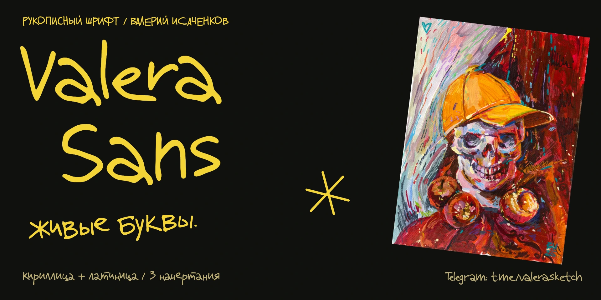
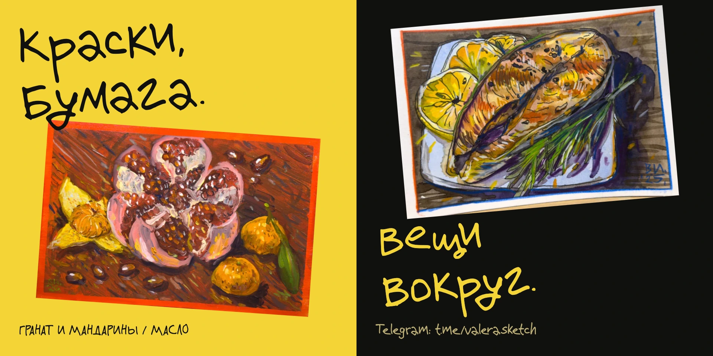

<div align="center">

# Valera Sans

Valery Isachenkov's handwriting, with a living line and both Cyrillic and Latin letters.

[Русский](README.md) · [English](README.en.md)



[Download 0.5.5](https://github.com/azbezd/valera-sans/releases/tag/v0.5.5) · [Try the font](https://azbezd.github.io/valera-sans/specimen/) · [License](LICENSE)

**Free personal and commercial use · attribution required · no font modifications.**

</div>

These letters began on the author's handwritten sheets and scans. Their tails, angles and irregularities carry through to the vector outlines. Use the family for artwork captions, posters, headings and personal projects that call for a distinct handwriting style.

## Start using it

Download the [ready-to-use package](https://github.com/azbezd/valera-sans/releases/download/v0.5.5/ValeraSans-0.5.5-fonts.zip). Install **either TTF or OTF** on your computer. For websites, use **WOFF2** with the supplied CSS.

| Style | Weight | Formats |
|---|---:|---|
| Light | 300 | TTF · OTF · WOFF2 |
| Regular | 400 | TTF · OTF · WOFF2 |
| Semibold | 600 | TTF · OTF · WOFF2 |

```html
<link rel="stylesheet" href="fonts/web/valera-sans.css">
```

```css
.handwriting {
  font-family: "Valera Sans", sans-serif;
  font-weight: 400;
  font-synthesis: none;
  font-kerning: normal;
  font-feature-settings: "calt" 1;
}
```

Keep the CSS alongside the three WOFF2 files. [Installation and usage details](docs/USAGE.md).

## The handwriting in use

Painting, drawing and lettering by the same artist. Two applications of the actual Valera Sans font: an art poster and an illustrated caption.



The paintings illustrate the font in use. Reusing the artwork reproductions separately requires [the author's permission](specimen/artworks/README.md).

## Letters and behavior

The Russian alphabet, including Ё/ё, basic Latin A–Z/a–z, digits, punctuation, ₽, № and °: **171 encoded characters and 529 glyphs**, including 348 additional handwritten alternates of 151 characters taken from the author's scans. They rotate automatically through `calt`: a repeated letter never repeats its shape, and forms vary pseudo-randomly across the text. The handwritten tails of `а` and `a` are preserved. Latin `r` changes shape immediately after lowercase Latin `e`: `er` uses the flowing form; `re` and an isolated `r` use the upright form. This is a built-in OpenType `calt` rule.

All three weights include pair kerning and tabular figures through `tnum`. The [interactive specimen](https://azbezd.github.io/valera-sans/specimen/) renders the actual fonts.

**0.5.5 is a preview release.** Light and Semibold remain experimental. Extended Latin, italics, a variable axis and dedicated hinting are not included. [Validation and limitations](docs/VALIDATION.md).

## Credit the author

Commercial projects are welcome. Include the font name, the author and the author's website in one reasonably accessible credit per project, such as its description, credits, colophon or attribution page.

> Valera Sans — Valery Isachenkov · [valerasketch.ru](https://valerasketch.ru)

Modifying, renaming or distributing a modified font requires separate permission from the author. Sources are published for inspection and reproducibility; this project **does not claim to be open source**. [Complete license](LICENSE) · [Ready-to-use credits](ATTRIBUTION.md).

## Project development

Editable UFO sources and the build are included. Official versions receive Git tags, with downloadable archives and checksums in GitHub Releases. Earlier local milestones are recorded in the [CHANGELOG](CHANGELOG.md).

[Build and release guide](docs/BUILD.md) · [Report an issue](https://github.com/azbezd/valera-sans/issues) · [Contribution terms](CONTRIBUTING.md).

## Author

Handwriting and artistic character by **Valery Isachenkov**. [Telegram channel: @valerasketch](https://t.me/valerasketch) · [The author's artwork](https://valerasketch.ru) · [GitHub](https://github.com/azbezd).

Cyrillic у selects its open form in reviewed contexts where the loop causes excessive spacing. Other contexts retain the looped form. [Complete context list](docs/CONTEXTS.md).
